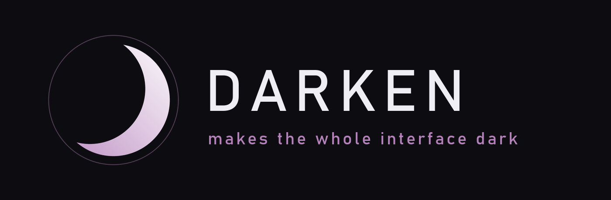

# Darken

A dark interface for World of Warcraft Classic - every window, at a
strength you choose.

Darken repaints the game's own interface instead of replacing it. The
game's frames stay; they get darkened, retextured and relettered. No
library pack to install: everything it needs ships with it.

| | |
|---|---|
| Install | drop the `Darken` folder into `Interface/AddOns` |
| Open the settings | type `/dark` in game, or click the minimap button |
| Found a bug | `/dark report` in game, then [open an issue](../../issues/new/choose) |
| Want to help | [CONTRIBUTING.md](CONTRIBUTING.md) |
| Terms of use | [LICENSE](LICENSE) |

## Installing

1. Close the game.
2. Copy the `Darken` folder into `World of Warcraft/<version>/Interface/AddOns`.
3. Start the game and make sure Darken is ticked on the character select
   screen.

There is nothing else to install.

## First run

One setting arrives already on: the darkening, at eighty out of a
hundred. An addon that exists to darken the interface is obliged to
darken it without being asked twice. Everything else is the game's own
look, and every list in the settings opens with the game's own entry -
that entry is the way back.

An existing profile keeps whatever strength it had.

1. Type `/dark` or click the button at the edge of the minimap. The
   settings window opens.
2. The darkening slider is the first thing on the first page. Drag it
   to nothing, or past eighty, or leave it alone.
3. **General** holds three ready-made Looks - Classic, Modern and the
   Author's. Each names exactly which settings it changes before it
   changes them, and touches nothing else.
4. Everything else is a page in the left column. Close the window when
   you are done; it saves as you go.

## What it does

### The darkening

One slider darkens the interface, and a tint colours it. The pass
starts at the interface's root and takes every window it can name, the
ones nobody remembers included.

Each area can be set apart from the rest: the bags, the chat, the
tooltips, the map, the conversation windows. The list of what to leave
alone is built out of what the pass really darkened, not out of a list
kept by hand.

Status bars are never darkened. A bar's fill shows a quantity, and
dimming it is dimming the needle of a gauge - its colour belongs to the
unit frames instead.

### Bar textures and colours

Nine textures of the addon's own for the health and power bars, plus
everything your other addons have put into LibSharedMedia. The colour
comes by class, by reaction, by power type, or one you pick.

A mob somebody else tapped stays grey, the way the game paints it: that
grey is the game's answer to "is this kill yours", and colouring over
it takes the answer away.

### Fonts

One font, size and outline for the whole interface, with separate
overrides for unit names, bar values, hotkeys, floating combat text and
the addon's own windows.

### Bar text

What the numbers on the health and power bars say, where they sit, and
whether a large number is shortened. It lives on the Unit Frames page,
beside the texture and colour of those same bars.

### Nameplates

The same textures and colours on the plates over heads, with rules for
which plates to draw at all. There is a plate engine of its own behind
the Rules tab, off until you switch it on; while it draws, the skinning
stands down and says so - one plate never has two owners.

### Borders

A one pixel line around action buttons, around buff and debuff icons,
and around the slots of the game's own bag windows. Darkening
multiplies the colour of what the game drew, and a line that is not
there is the one thing it cannot draw. Off by default.

### Its own parts

Six parts ship inside the addon, each a row in the settings window and
each off until you turn it on - a fresh install draws nothing of its
own:

| Part | What it does | Command |
|---|---|---|
| **Compact Auras** | A grid of buffs and debuffs in place of the game's: icon size, icons per row, growth direction, time and stacks, a filter by spell list, per-spell rules, and the same grid on the unit frames. | `/dark auras` |
| **Information Panel** | A bar of metrics at the edge of the screen - gold, durability, free bag space, latency, framerate, time, experience, reputation - and whatever your other LibDataBroker addons publish. | `/dark info` |
| **Item Level** | Item level over an item's icon: in the character sheet, in inspect and in the bags. | `/dark ilvl` |
| **Durability** | Your worst-worn piece as a block on screen, shown once it drops below a threshold you set. | `/dark dura` |
| **Away** | A dark card over the screen while the game marks you away, with the whispers and letters that arrived meanwhile. It leaves for good the moment something wants you - combat, a ready check, an invite. | `/dark afk` |
| **Nameplates** | The plate engine named above. | `/dark plates` |

They live under `Features/Auras`, `Features/InfoPanel`,
`Features/ItemLevel`, `Features/Durability`, `Features/Away` and
`Features/NamePlates` - one folder each, loaded by the same TOC. There
is nothing to download separately. A part's command reports its state
and opens its page; the row in the settings window does the same thing
without typing.

The addon's own elements - the aura grid, the durability block, the
info panel - are dragged where you want them, with an optional grid to
snap against and a reset for one or for all. The game's own frames are
not in that list, and that is the engine's rule rather than a gap: on a
client with Edit Mode they belong to it.

### Profiles

Shared across the account; which profile a character uses is that
character's own choice. Changes apply at once - no interface reload.

### The settings window

Every setting is shown. There is no simple-versus-everything switch and
no setting hidden behind one: a setting you cannot find is no better
than a setting that is not there. The search box at the top narrows the
column to what you are looking for.

The left column lists what a player does, not how the addon is built.

## Supported clients

| Line | Interface |
|---|---|
| Classic Era | 11507, 11509 |
| Classic 1.60 | 16001 |
| TBC Classic | 20504, 20506 |
| Mists Classic | 50500, 50504 |

Retail is out of scope.

Darken never decides by a version number - it asks the client which
frames it actually has, so a section for something your client does not
have is not shown at all.

## Current state

Version 1.0.1. What changed from one version to the next is in
[CHANGELOG.md](CHANGELOG.md).

## Commands

```
/dark           open the settings window  (/darken and /dk do the same)
/dark window    open it by a word of its own
/dark auras     the parts above, one word each: auras, info, ilvl,
                dura, afk, plates
```

When something looks wrong, Darken can describe its own state. Run the
command that matches and send the output - it answers more than a
screenshot does:

```
/dark report         which parts of this client's interface exist, and
                     which subsystems therefore did nothing
/dark probe          why the window you just opened did not go dark;
                     name a frame to probe that one, or "mouse" to
                     probe what the cursor is on
/dark scan <text>    frames whose names contain the text
```

Those three only read: nothing on screen changes. A handful of lines
land in chat and the full detail goes into the saved variables, so
logging out and sending the saved file is the whole of a bug report.
It is `WTF/Account/<account>/SavedVariables/Darken.lua` - named after
the addon, not after the `DarkenDB` variable inside it.

Two more exist to check how the settings window is drawn, which can
only be judged by eye:

```
/dark demo      the sample section of the settings window
/dark widgets   one of each widget the window is built from
```

## Reporting a bug

Run `/dark report`, log out, and attach
`WTF/Account/<account>/SavedVariables/Darken.lua` to an
[issue](../../issues/new/choose). If one particular window stayed
bright, run `/dark probe` with that window open first - it names a
verdict per texture, and that is usually the answer by itself.

## Modules by other authors

Darken opens a contract for addons written against it: registration,
shared settings, contract versions and failure isolation, so a broken
module cannot take the core down with it. The contract itself is
[`Core/Api.lua`](Core/Api.lua) - one global object, and the comments in
that file say what each door is for and why it is shaped the way it is.
The written version, `docs/module-api.md`, is not in this repository;
ask for it in an issue. A module's settings appear under a **Modules**
row, which exists only while such a module is loaded.

## Separate addons

Two things grew up here and left for addons of their own, each standing
on its own foundation with not one line about Darken: **Rack** for the
action bars and **Hive** for the party and raid frames. Neither needs
Darken, and Darken needs neither.

## Development

The libraries are not kept in the repository. Before the first run:

```
tools/fetch-libs.ps1
```

The tests of the pure logic (LuaJIT required):

```
luajit tests/run.lua
```

The branding images are redrawn from the palette:

```
python tools/make_branding.py
```

The store gallery is rebuilt from the raw captures in
`Media/shots/raw`:

```
python tools/shots.py
```

The release archive:

```
tools/package.ps1
```

Nothing has to be published to the game separately. The addon is one
folder and the parts under `Features/` are its own files: if this
repository sits in `Interface\AddOns\Darken`, the game already sees all
of it.

## Credits

Ace3 and LibSharedMedia-3.0 ship with the addon and keep their own
licences. LibDataBroker displays are read from whatever addons publish
them; none is bundled.

## Licence

Darken is free to use and free to download, but it is not open source:
redistribution, forks and re-uploads are not allowed. The full terms
are in [LICENSE](LICENSE); if you want to do something they forbid,
open an issue and ask.

World of Warcraft and Blizzard Entertainment are trademarks of Blizzard
Entertainment, Inc. Darken is an unofficial addon and is not affiliated
with Blizzard Entertainment.
